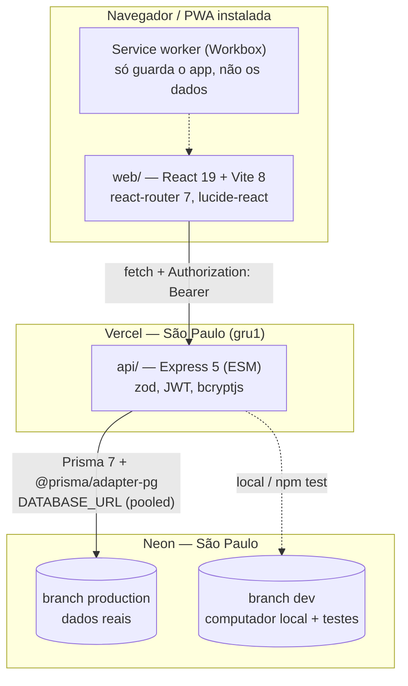
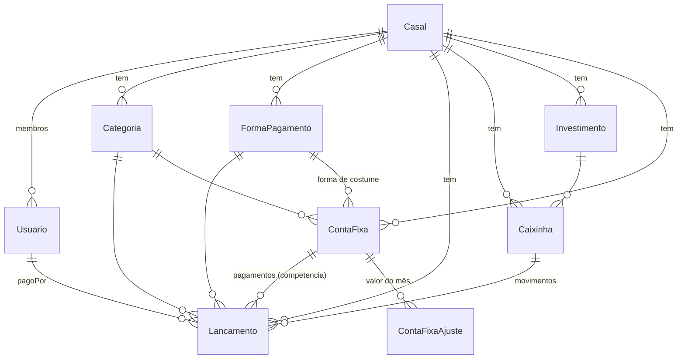
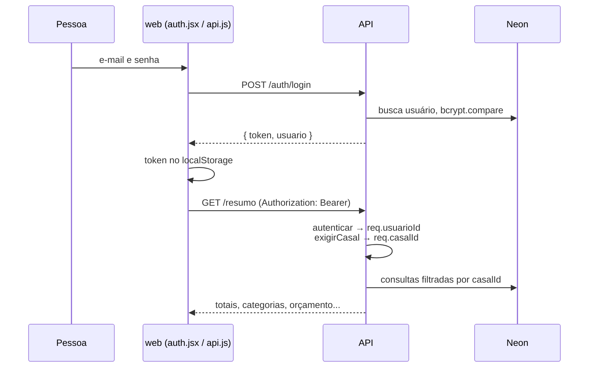
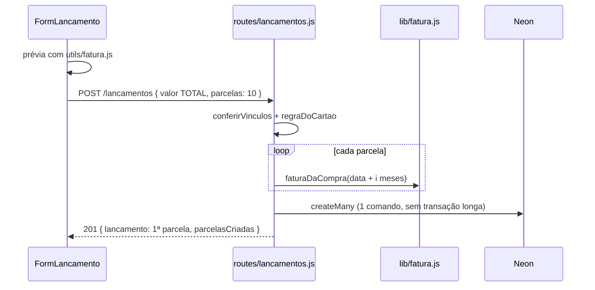

# Mapa do código: Casa em Conta

> Gerado com o Cartographer. Último mapeamento: 2026-11-10 (UTC).
> Regras de negócio e decisões do usuário ficam no [CLAUDE.md](../CLAUDE.md); o guia visual no [DESIGN.md](../DESIGN.md). Este arquivo mostra **onde** cada coisa está no código.

## Visão geral



- **Front** (`web/`): SPA publicada em https://financas-casal-gold.vercel.app. Só uma variável: `VITE_API_URL`.
- **API** (`api/`): https://financas-casal-api-beta.vercel.app. Variáveis: `DATABASE_URL`, `JWT_SECRET`, `WEB_URL` (CORS). Localmente também `DIRECT_URL`, `PRODUCAO_DATABASE_URL` e `PRODUCAO_DIRECT_URL`.
- **Sem estado compartilhado no front:** cada página busca o que precisa com `api()` dentro de `useEffect`. Os únicos estados globais são o login (`AuthProvider`) e o "olho" (`utils/dinheiro.js`).

## Estrutura de pastas

```
financas-casal/
├── CLAUDE.md, DESIGN.md        regras do projeto e guia visual
├── Ideia Design/               telas de referência (PNG)
├── docs/CODEBASE_MAP.md        este mapa
├── api/
│   ├── package.json            scripts dev/start/test/db:*; Prisma fixado em 7.10.1
│   ├── prisma.config.js        CLI do Prisma usa DIRECT_URL (sem pooler)
│   ├── vercel.json             regions: ["gru1"]
│   ├── prisma/
│   │   ├── schema.prisma       modelos e enums
│   │   ├── migrations/         7 migrações (init → fatura_do_cartao)
│   │   └── seed.js             cria "Casal Exemplo" — NÃO rodar no Neon
│   ├── scripts/migrar-producao.js   migrate deploy apontando para produção
│   ├── src/
│   │   ├── server.js           confere variáveis e liga a porta 3333
│   │   ├── app.js              middlewares, rotas, 404 e erro 500
│   │   ├── lib/                regras puras e utilitários (datas, fatura, saldos...)
│   │   ├── middlewares/        autenticar, exigirCasal, limitarTentativas
│   │   └── routes/             um arquivo por recurso
│   └── tests/
│       ├── api.test.js         liga a API numa porta livre e roda os cenários
│       └── cenarios/*.mjs      9 cenários com usuários teste-*@exemplo.com
└── web/
    ├── index.html              viewport sem zoom, ícones Apple
    ├── vite.config.js          React + PWA (manifest, Workbox)
    ├── pwa-assets.config.js    gera ícones (npm run icones)
    ├── vercel.json             rewrite de SPA → index.html
    ├── public/brand/           logo, ícones PNG, favicon
    └── src/
        ├── main.jsx            registra SW, bloqueia gesto de zoom, monta o app
        ├── App.jsx             tabela de rotas + guardas de login/casa
        ├── api.js              fetch com token (localStorage)
        ├── auth.jsx            AuthProvider / useAuth
        ├── styles/tokens.css   cores, espaços, raios (claro e escuro)
        ├── index.css           todo o CSS das telas (~1500 linhas)
        ├── components/         peças reutilizáveis (Layout, Cabecalho, gráfico...)
        ├── hooks/              useValoresOcultos
        ├── utils/              dinheiro, datas, fatura, exportar CSV...
        └── pages/              uma tela por arquivo
```

## API (`api/`)

### Ciclo de uma requisição (`src/app.js`)

1. `trust proxy` (IP real na Vercel, para o limite de tentativas)
2. `cors` com as origens de `WEB_URL` (separadas por vírgula)
3. `express.json()`
4. `GET /health` e `GET /health/db`
5. Rotas: `/auth`, `/casal`, `/categorias`, `/lancamentos`, `/caixinhas`, `/investimentos`, `/resumo`, `/contas-fixas`, `/formas-pagamento`, `/faturas`
6. 404 `{ erro: 'Rota não encontrada.' }`
7. Erro: JSON inválido → 400; qualquer outro → log + 500 "Erro interno". O Express 5 já manda os erros de funções `async` para cá.

**Proteção:** tirando `/auth` e `/casal`, todas as rotas fazem `router.use(autenticar, exigirCasal)` e filtram por `req.casalId`. O `/casal` usa `autenticar` em tudo e `exigirCasal` rota a rota (criar e entrar acontecem antes de ter casa).

### `src/lib/`

| Arquivo | O que faz | Usado por |
|---|---|---|
| `prisma.js` | `prisma` (cliente com adapter pg) e `OPCOES_TRANSACAO` (15 s) | todas as rotas |
| `validar.js` | `validar(schema, dados, res)` responde 400 e devolve `null`; `idSchema`, `dataSchema` (rejeita 30/02), `mesSchema`, `iconeSchema`, `paraData` / `paraTexto` (UTC) | quase todas as rotas (não `auth` nem `casal`) |
| `datas.js` | "hoje" no fuso de São Paulo, `vencimentoNoMes` (31 → último dia), `somarMeses`, `mesesEntre`, `diasEntre` | contasFixas, faturas, resumo |
| `fatura.js` | `faturaDaCompra`, `datasDaFatura`, `situacaoDaFatura`, `faturasDoCartao`, `faturasQueVencemNoMes` | lancamentos, contasFixas, faturas |
| `saldos.js` | `calcularSaldos(casalId, tx?)` → função `saldoDe(id)`; `efeitoNoSaldo` | caixinhas, investimentos |
| `convite.js` | código `XXX-XXX` com `crypto`, normalizar, validade de 7 dias | casal |
| `categoriasPadrao.js` / `formasPadrao.js` | o que uma casa nova recebe (6 categorias; Pix, Débito, Dinheiro, Boleto) | casal, seed |

### `src/middlewares/`

- **`autenticar.js`**: lê o `Bearer`, verifica o JWT e coloca `req.usuarioId`. Não confere se o usuário ainda existe.
- **`exigirCasal.js`**: busca `casalId` e `papel`; sem casa → 403.
- **`limitarTentativas.js`**: `limiteLogin` (10/15 min), `limiteCadastro` (5/60 min), `limiteConvite` (10/15 min). Só liga com `NODE_ENV=production`. A contagem fica na memória de cada instância da Vercel.

### Rotas (`src/routes/`)

| Arquivo | Endpoints principais | Regras que moram aqui |
|---|---|---|
| `auth.js` | `POST /cadastro`, `POST /login`, `GET /eu` | bcrypt custo 10; JWT 30 dias; login sempre compara com um hash falso (não revela e-mail cadastrado) |
| `casal.js` | `POST /`, `POST /entrar`, `GET /`, `POST /convite`, `DELETE /lancamentos` | no máximo 2 titulares; o convite some quando a casa completa; apagar dados exige o nome da casa |
| `categorias.js` | CRUD | nome único por casa; `limiteMensalCentavos` = orçamento |
| `lancamentos.js` | `GET ?mes=` ou `?de=&ate=`, `GET/POST/PATCH/DELETE` | só RECEITA/DESPESA; compra no cartão ganha `faturaMes`; parcelas com `createMany` (sobra de centavos na 1ª); `?todasParcelas=1`; recusa editar movimentos de meta e FATURA |
| `caixinhas.js` | CRUD + `/guardar`, `/resgatar`, `/atualizar-saldo`, `DELETE /movimentos/:id` | saldo calculado em transação; não resgata mais que o saldo; arquivar só com saldo 0; apagar só sem histórico |
| `investimentos.js` | CRUD | saldo = soma das metas ligadas |
| `resumo.js` | `GET /` (totais, categorias, orçamento, formas, últimos) e `GET /evolucao` | duas visões: dinheiro (Saiu = despesas fora do cartão + faturas) e consumo (categorias/orçamento por data da compra) |
| `contasFixas.js` | CRUD, `GET /mes`, `PUT/DELETE /:id/valor-mes`, `POST /:id/pagar` | sem retroativo; parcelas; ajuste do mês; "Pagar" cria o lançamento (`competencia` única) |
| `formasPagamento.js` | CRUD | dias de fechamento/vencimento só no crédito; cartão com compras não muda de tipo nem é apagado |
| `faturas.js` | `GET /`, `GET /:cartaoId?mes=`, `POST /:cartaoId/pagar`, `DELETE /:cartaoId/pagamento?mes=` | paga sempre a fatura inteira (lançamento FATURA) |

### Banco (`prisma/schema.prisma`)



- **`Lancamento.tipo`**: `RECEITA`, `DESPESA`, `GUARDADO` / `RESGATE` / `RENDIMENTO` (meta, exigem `caixinhaId`) e `FATURA` (pagamento do cartão).
- **Únicos:**
  - `[casalId, nome]` em Categoria, Investimento e FormaPagamento.
  - `[contaFixaId, competencia]` em Lancamento e em ContaFixaAjuste.
- **Exclusões:** apagar a casa apaga tudo em cascata. Categoria, forma de pagamento e conta fixa apagadas deixam os lançamentos com o campo vazio (`SetNull`). Uma meta com movimentos não pode ser apagada no banco (`NoAction`).
- `Usuario.rendaMensalCentavos` sobrou da divisão proporcional (removida) e nenhuma rota usa.

## Front (`web/`)

### Rotas (`src/App.jsx`)

| Caminho | Tela | Onde |
|---|---|---|
| `/` | `Inicio` | dentro do Layout (`.tela.larga`) |
| `/lancamentos` | `Lancamentos` ("Extrato") | Layout |
| `/metas`, `/metas/:id` | `Caixinhas`, `CaixinhaDetalhe` | Layout |
| `/investimentos` | `Investimentos` | Layout |
| `/contas` | `Contas` | Layout (aba só no computador) |
| `/cartoes/:id` | `Cartao` | Layout (sem aba própria) |
| `/casa`, `/casa/categorias`, `/casa/formas`, `/casa/ajuda` | `Casa`, `Categorias`, `FormasPagamento`, `Ajuda` | Layout |
| `/lancamentos/novo`, `/lancamentos/:id` | `FormLancamento` | tela cheia |
| `/metas/nova`, `/metas/:id/editar` | `FormCaixinha` | tela cheia |
| `/contas/nova`, `/contas/:id/editar` | `FormContaFixa` | tela cheia |
| `/bem-vindo` | `Espaco` (criar casa / entrar com código) | logado, sem casa |
| `/login`, `/cadastro` | `Login`, `Cadastro` | públicas |

Guardas em `App.jsx`:
- `RotaDaCasa`: precisa de login e de casa.
- `RotaSemCasa`: precisa de login e de não ter casa.
- `RotaPublica`: quem já está logado vai para `/`.

### Componentes (`src/components/`)

| Arquivo | Papel |
|---|---|
| `Layout.jsx` | coluna de 100dvh: `.conteudo-rolavel` + `.navegacao`; correções de rolagem do iPhone; "+" central |
| `Cabecalho.jsx` | topo das abas principais (marca, título, olho, espaço à direita) |
| `SeletorMes.jsx` | `<select>` transparente sobre o texto do mês |
| `ItemLancamento.jsx` | linha da lista com 4 variações: movimento de meta, FATURA, compra no cartão (sem sinal) e normal |
| `GraficoEvolucao.jsx` | barras Entrou × Saiu em SVG feito à mão, dica no hover, "Ver em tabela" |
| `EscolherForma.jsx` | chips de forma de pagamento |
| `Icone.jsx` | ícone lucide pelo nome salvo no banco |
| `Marca.jsx`, `Progresso.jsx` | logo das telas de entrada; barra de progresso da meta |

### Utilitários (`src/utils/`) e hook

- **`dinheiro.js`**: `formatarReais` (devolve `R$ ••••` com o olho fechado), `textoParaCentavos`, `centavosParaTexto`, e o "store" do olho (`valoresOcultos`, `alternarValoresOcultos`, `aoMudarOcultar`).
- **`hooks/useValoresOcultos.js`**: `useSyncExternalStore` do olho. Toda tela que mostra dinheiro chama esse hook para redesenhar.
- **`datas.js`**: nomes de mês e dia, `dataRelativa`, `segundaDaSemana`, `mesesParaEscolher`.
- **`fatura.js`**: cópia da regra da API, só para a prévia "vai para a fatura de…".
- **Demais arquivos:**
  - `exportar.js`: CSV no padrão do Excel BR e compartilhar/baixar.
  - `contas.js`: texto do vencimento e ordem dos pendentes.
  - `caixinhas.js`: porcentagem e frase de planejamento.
  - `formas.js`, `icones.js`: listas de tipos e de ícones.

### Estilos

- **`tokens.css`**: todas as cores (claro e escuro via `prefers-color-scheme`), espaços e raios. A fonte Plus Jakarta Sans vem do Google Fonts.
- **`index.css`**: base e tipografia, depois estrutura (`.tela`, `.area-logada`), componentes, barra de navegação, trava de rolagem da página e, por último, o bloco do computador.
- **Breakpoint:** só `@media (min-width: 1024px)`. A partir dele:
  - a navegação vira barra lateral de 248px;
  - `.tela` vai a 880px e `.tela.larga` a 1280px;
  - o `.painel-inicio` vira um grid de 2 colunas com `grid-template-areas` (classes `area-*`).

## Fluxos principais

### Login e uso de rota protegida



Ao abrir o app, `auth.jsx` chama `GET /auth/eu`. Se o token estiver inválido, ele é apagado e a pessoa vai para `/login`.

### Compra parcelada no cartão



A compra **não** entra no "Saiu". Ela só conta quando alguém paga a fatura (`POST /faturas/:id/pagar`), que cria um lançamento `FATURA`.

### Conta fixa no mês

`GET /contas-fixas/mes` monta a lista na hora a partir de `ContaFixa`, `ContaFixaAjuste` e os pagamentos existentes. "Pagar" cria o `Lancamento` com `contaFixaId` e `competencia`. Desfazer = `DELETE /lancamentos/:id`.

## Convenções

- **Nomes em português:**
  - "casal" e "caixinha" por dentro; "casa" e "Metas" na tela.
  - `/lancamentos` é a aba "Extrato".
- **Dinheiro e datas:**
  - Dinheiro sempre em centavos (`Int`).
  - Datas como texto `AAAA-MM-DD`, convertidas em UTC.
  - Meses como `AAAA-MM`.
- **Erros da API:** sempre `{ erro: "mensagem" }`. A validação zod devolve 400 com a primeira mensagem. Nome repetido (P2002) vira 409. Apagar devolve 204.
- **`ErroDeRegra(status, mensagem)`:** classe local nas rotas mais complexas, para sair de dentro de transações com uma resposta amigável.
- **Telas:**
  - O "carregando" é `useState(null)`.
  - Respostas atrasadas são ignoradas (flag `cancelado`, ou conferindo o mês da resposta).
  - Confirmações usam `window.confirm` / `window.prompt`.
- **Filtros na URL:** `?mes=`, `?modo=semana&de=`. O mês atual = sem parâmetro.
- **Voltar dos formulários:** `history.state.idx > 0 ? navigate(-1) : navigate(rotaPadrão)`.

## Cuidados (gotchas)

1. **Transações curtas:** o limite do Prisma é 5 s. Para inserir vários registros use `createMany`. Transações interativas usam `OPCOES_TRANSACAO`.
2. **Fuso diferente entre rotas:**
   - `/resumo` e `/lancamentos` usam o mês atual em **UTC** quando não recebem `?mes=`.
   - `/contas-fixas/mes` usa o fuso de **São Paulo**.
   - Na virada do mês (entre 21h e 0h em SP) os padrões podem divergir. O front sempre manda `?mes=`, então hoje isso não aparece.
3. **Trava dos testes:** compara `DATABASE_URL` com `PRODUCAO_DATABASE_URL`. Se essa variável faltar no `.env`, a trava não protege nada. Por isso ela está listada no `api/.env.example`.
4. **Limpeza dos testes:** apaga TODOS os usuários `teste-*`, não só os do cenário. Por isso os testes rodam em série (`--test-concurrency=1`).
5. **Corridas raras (dois toques simultâneos):**
   - Dois resgates ao mesmo tempo podem passar, porque a transação não trava a linha.
   - Dois pagamentos da mesma fatura também: não há índice único para FATURA por cartão e mês.
6. **Sem tratamento global de 401 no front:** um token vencido no meio do uso aparece como mensagem de erro, sem levar ao login.
7. **Atualização da PWA:** é automática e imediata. Um deploy recarrega o app mesmo com um formulário aberto.
8. **CSV ignora o olho:** de propósito, sempre exporta valores reais.
9. **`Espaco.jsx`:** marca `papel: 'TITULAR'` no front depois de entrar. O `/auth/eu` corrige no próximo carregamento.
10. **OneDrive + Vite:** às vezes o navegador mostra a versão antiga. Salve de novo ou reinicie o `npm run dev`.
11. **Documentação desatualizada:**
    - DESIGN.md ainda fala em 4 abas e largura de 480px no computador.
    - `web/README.md` ainda é o modelo do Vite.

## Guia de navegação

- **Nova rota na API:**
  - criar ou editar `api/src/routes/<recurso>.js` com `router.use(autenticar, exigirCasal)`, schemas zod e `validar`;
  - registrar em `api/src/app.js`;
  - criar um cenário em `api/tests/cenarios/` e incluí-lo na lista de `api/tests/api.test.js`.
- **Mudar o banco:**
  - editar `api/prisma/schema.prisma`;
  - gerar a migração (veja "Banco" no CLAUDE.md);
  - rodar `npm run db:generate`;
  - antes do push, o usuário roda `npm run db:migrar-producao`.
- **Nova tela:**
  - criar `web/src/pages/<Tela>.jsx`;
  - adicionar a rota em `web/src/App.jsx` (dentro do Layout ou em tela cheia);
  - se for uma aba, adicionar em `web/src/components/Layout.jsx`;
  - estilos em `web/src/index.css`, usando só tokens;
  - atualizar o texto de `web/src/pages/Ajuda.jsx`.
- **Regra de cartão/fatura:** `api/src/lib/fatura.js` (a verdade) e `web/src/utils/fatura.js` (a prévia). Mude os dois juntos.
- **Totais do mês:** `api/src/routes/resumo.js` (Início e Evolução) e `api/src/routes/lancamentos.js` (Extrato). As fórmulas estão repetidas nos dois.
- **Login e sessão:** `api/src/routes/auth.js`, `api/src/middlewares/autenticar.js`, `web/src/auth.jsx`, `web/src/api.js`.
- **Visual do computador:** o bloco `@media (min-width: 1024px)` no fim de `web/src/index.css`.
- **Ícones:** importar em `web/src/utils/icones.js` e adicionar em `ICONES` (e em `ICONES_CATEGORIA` ou `ICONES_META`).
